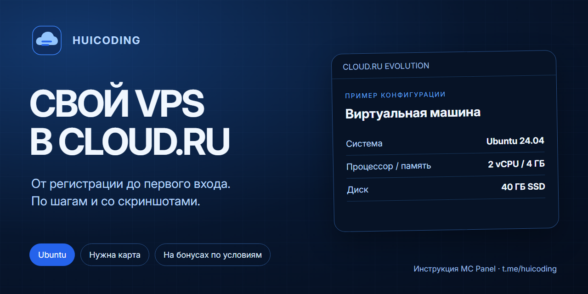

# 🖥️ СВОЙ VPS В CLOUD.RU — **ПО ШАГАМ**

✅ От регистрации до первого входа на сервер.

🖼️ Скриншоты и шаги из инструкции MC Panel.

⚠️ Нужна банковская карта. Бонусы ограничены по сумме и сроку; актуальные условия проверьте в своём кабинете. Это не бессрочный бесплатный VPS.

---

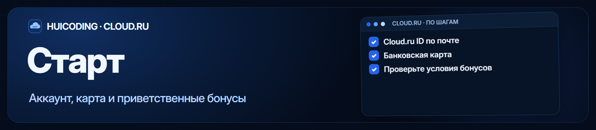

🧑‍💻 **1. Создайте аккаунт**

Откройте [console.cloud.ru](https://console.cloud.ru/) → «Зарегистрироваться». Используйте почту и пароль (Cloud.ru ID). Сбер ID не обязателен.

*Привяжите банковскую карту, когда сервис её попросит. После входа откроется Cloud.ru Evolution.*

📋 **2. Проверьте грант**

*Нажмите на плашку баланса → «Контроль затрат» → «Гранты». Проверьте доступную сумму и дату окончания. В исходной инструкции показан «Тест Evolution (4 000 Б)» примерно на два месяца; у вас условия могут отличаться.*

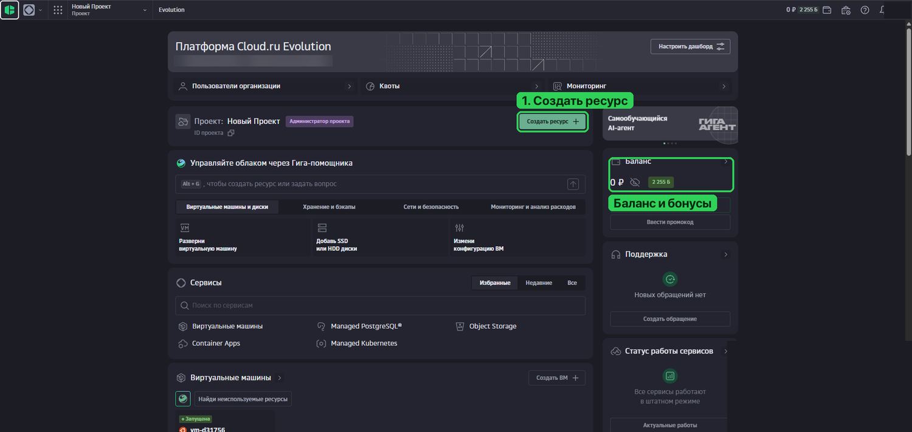

*Главная страница: где создавать ресурс и смотреть баланс.*

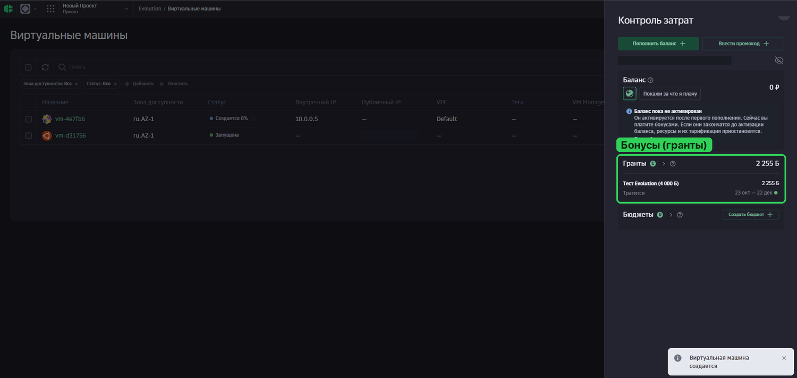

*«Контроль затрат»: сумма и сроки гранта в примере из инструкции.*

---

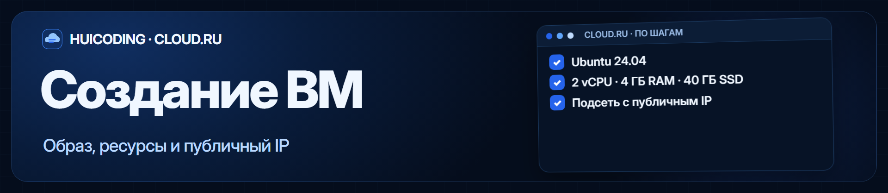

🖥️ **3. Откройте создание ВМ**

*«Создать ресурс +» → «Виртуальная машина». Количество — 1. Название — например minecraft; зона в примере — ru.AZ-1. GPU выключен.*

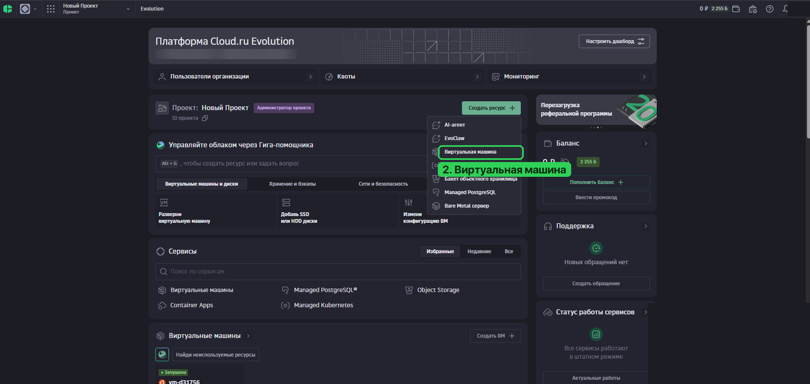

*Откройте пункт «Виртуальная машина».*

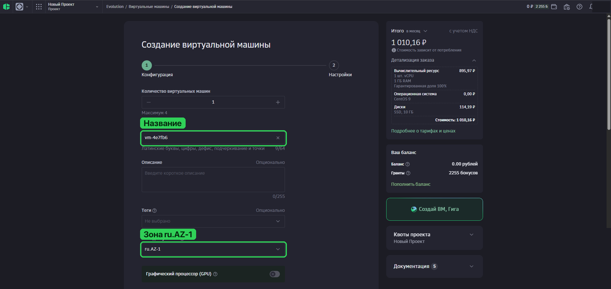

*Задайте название и зону доступности.*

⬇️ **4. Выберите Ubuntu**

*«Образ» → «Публичные ОС» → Ubuntu 24.04. Подойдёт и Ubuntu 22.04. Если по умолчанию стоит CentOS 9 — смените образ.*

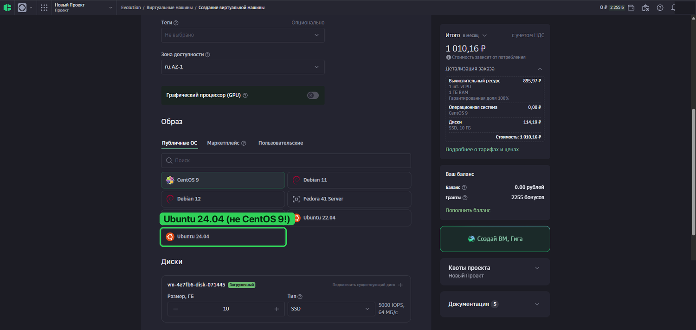

*Нужный образ — Ubuntu 24.04.*

🖥️ **5. Настройте ресурсы**

*Для MC Panel в инструкции выбран пример: 2 vCPU, 4 ГБ RAM, 40 ГБ SSD. Минимум — 2 ГБ памяти и 20 ГБ диска. Это пример конфигурации для панели, а не требование для любого VPS.*

*В поле размера диска вручную впишите 40 ГБ: на исходном скриншоте ещё видно значение 10. Справа проверяйте итоговую стоимость вашей конфигурации; цена на скриншотах относится к демонстрационному выбору. Нажмите «Продолжить».*

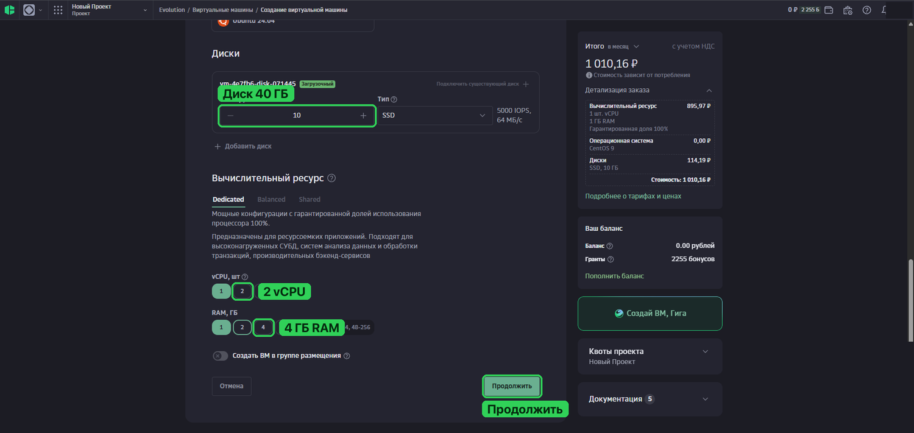

*Пример настройки ресурсов: задайте 40 ГБ SSD, 2 vCPU и 4 ГБ RAM.*

🌐 **6. Добавьте публичный IP**

*«Сетевой интерфейс №1» → «Подсеть с публичным IP». В примере: VPC Default, подсеть 10.0.0.0/24, внутренний IP автоматически. Группу безопасности создадим на следующем шаге.*

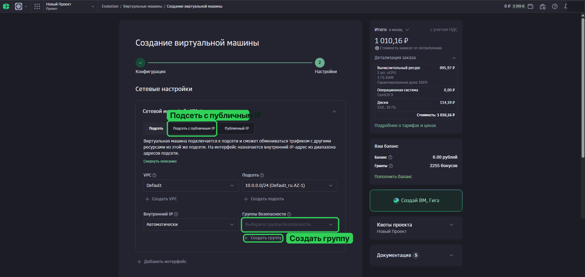

*Для доступа из интернета выберите «Подсеть с публичным IP».*

🔑 **7. Задайте пользователя**

*Оставьте логин user1. Для входа через виртуальную консоль выберите «Пароль» и задайте длинный надёжный пароль. Для SSH можно сразу выбрать «Публичный ключ».*

*Сохраните данные входа. После настройки группы безопасности нажмите «Создать»; по инструкции создание занимает 1–3 минуты.*

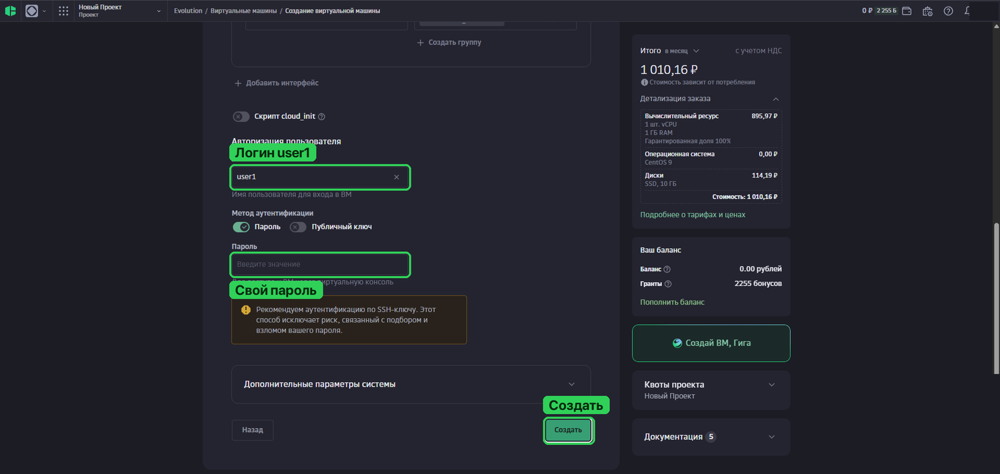

*Логин user1 и метод входа. Пароль придумайте свой.*

---

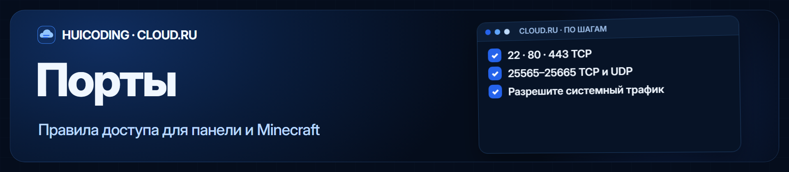

🛡️ **8. Создайте группу безопасности**

*В форме ВМ под полем «Группы безопасности» нажмите «Создать группу». Или откройте сервис «Группы безопасности» → «Создать группу безопасности +». Зона должна совпадать с машиной.*

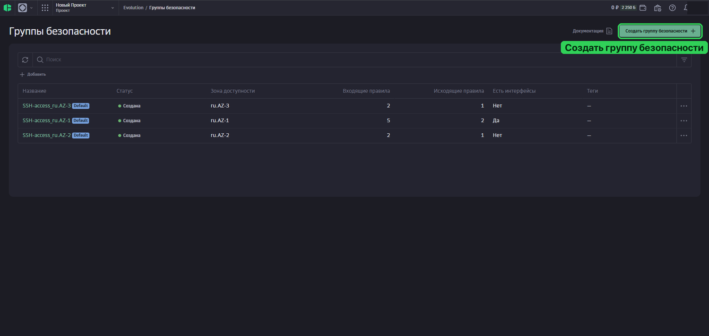

*Раздел «Группы безопасности» и кнопка создания.*

🔗 **9. Разрешите нужные порты**

*В «Правилах входящего трафика» нажимайте «+ Добавить правило». Для MC Panel и Minecraft:*

✅ 22 TCP — SSH

✅ 80 TCP — панель

✅ 443 TCP — HTTPS

✅ 25565–25665 TCP и UDP — Minecraft (два правила).

*Если спрашивает источник, в инструкции используется 0.0.0.0/0. Для другого приложения открывайте только нужные ему порты.*

⚠️ Если появилось предупреждение о блокировке системного трафика, нажмите кнопку его разблокировки под предупреждением. Иначе можно потерять сеть.

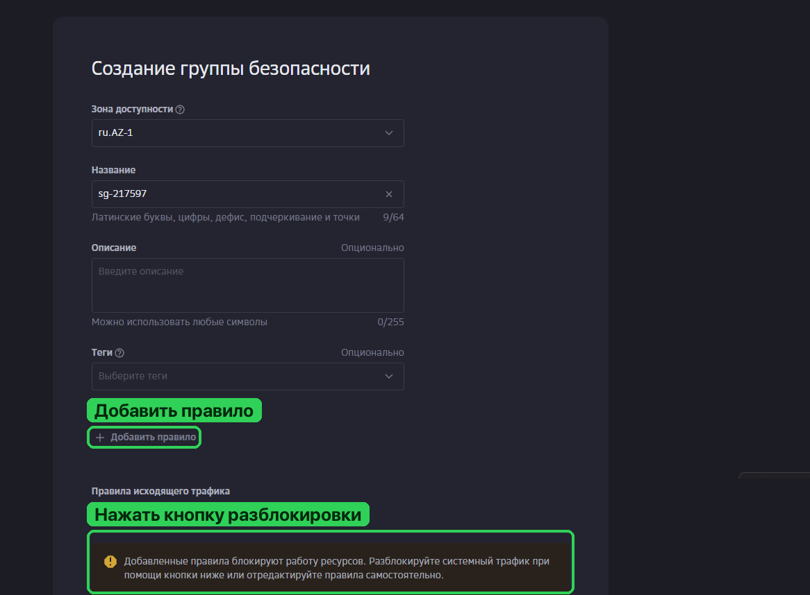

*Добавьте правила и разблокируйте системный трафик, если появился такой запрос.*

📋 **10. Примените группу**

*Сохраните группу и выберите её в настройках вашей ВМ. Если машина уже создана — проверьте, что группа действительно к ней привязана. Готовая SSH-access сама по себе не открывает порты панели и Minecraft.*

---

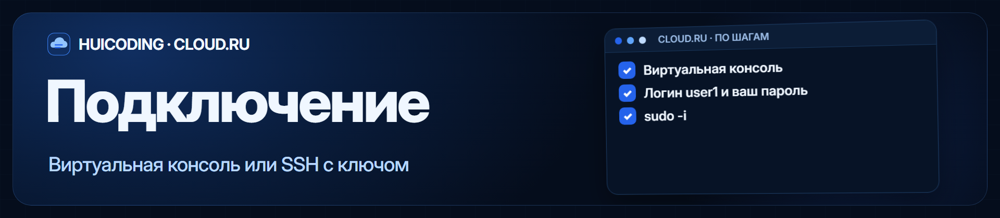

🌐 **11. Найдите адрес**

*«Сервисы» → «Виртуальные машины». Дождитесь статуса «Запущена» и скопируйте «Публичный IP».*

💻 **12. Войдите через браузер**

*Карточка машины → «Виртуальная консоль». Введите user1 и заданный пароль. Символы пароля не отображаются — это нормально.*

*Получите права администратора:*

```bash
sudo -i
```

*Должно появиться приглашение root@…:~#. Если не вставляется текст, попробуйте Ctrl+Shift+V или правую кнопку мыши.*

⚠️ В образах Cloud.ru, описанных в инструкции, SSH с паролем отключён. Пароль от user1 используйте в виртуальной консоли; для SSH нужен ключ.

🔒 **Если забыли пароль**

*Карточка машины → «Настройки авторизации» → «Установить новый пароль».*

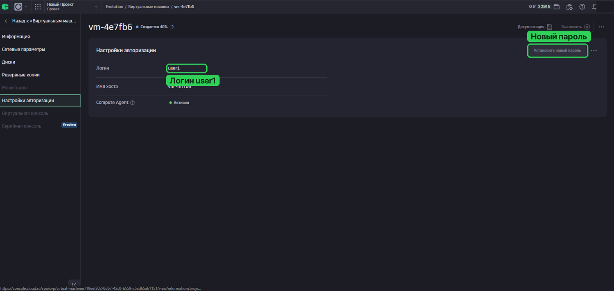

*Где посмотреть логин user1 и задать новый пароль.*

🔑 **Если хотите входить по SSH**

*При создании ВМ выберите «Публичный ключ» и вставьте открытый SSH-ключ. На компьютере ключ создаётся командой:*

```bash
ssh-keygen -t ed25519
```

*В Cloud.ru добавляется только открытая часть — файл с окончанием .pub. Затем подключайтесь:*

```bash
ssh user1@ВАШ_IP
```

```bash
sudo -i
```

Добавление ключа к уже созданной машине разобрано в [полной инструкции](https://github.com/minchiki/mc-panel/blob/main/docs/CLOUDRU.md#шаг-5-подключитесь-к-серверу).

---

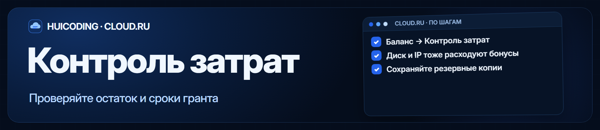

📋 **Следите за расходами**

*Остаток и срок бонусов смотрите в «Контроле затрат». Мощность ВМ влияет на скорость расхода; срок гранта не означает, что любой сервер проработает весь этот срок.*

*Диск и IP могут расходовать бонусы, даже если ВМ выключена. Лишние тестовые ресурсы удаляйте через кабинет. Не активируйте платный баланс, если не готовы оплачивать ресурсы.*

*В примере инструкции до первого пополнения используется бонусный баланс, а при его исчерпании ресурсы приостанавливаются. Условия своего аккаунта проверьте в кабинете.*

🗄️ **Сохраняйте данные**

*Бэкапы миров и важных файлов держите также на своём компьютере. При удалении ВМ можно потерять данные на ней.*

---

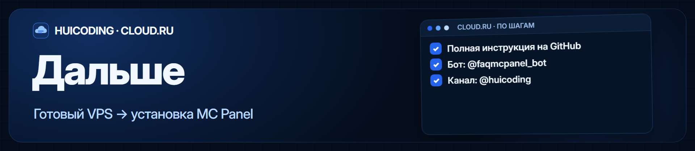

🚀 **VPS готов — можно устанавливать MC Panel.**

📖 **Продолжение**

Установка панели, первый вход и создание Minecraft-сервера — в [быстром старте](https://github.com/minchiki/mc-panel/blob/main/docs/QUICKSTART.md).

🤖 **Помощь**

Если застряли: [@faqmcpanel_bot](https://t.me/faqmcpanel_bot). Новости: [@huicoding](https://t.me/huicoding).

> ⭐ Сохраните пост, чтобы вернуться к шагам при настройке.

*Основа: docs/CLOUDRU.md репозитория minchiki/mc-panel. Интерфейс и условия облака могут меняться.*

[📖 Полная инструкция с фото](https://github.com/minchiki/mc-panel/blob/main/docs/CLOUDRU.md)

[🚀 Установить MC Panel](https://github.com/minchiki/mc-panel/blob/main/docs/QUICKSTART.md)

[🤖 Бот-помощник](https://t.me/faqmcpanel_bot)

[📢 HUICODING](https://t.me/huicoding)

---

## Материалы поста

- [Синие баннеры](assets/banners)
- [Скриншоты из инструкции](assets/screenshots)
- [35 стилизованных эмодзи: PNG и SVG](assets/emoji)
- [Эмодзи в Telegram](https://t.me/addemoji/cloudru_blue_by_fdsfsddsfssd_bot)
- [Макет Telegram-поста](telegram/post.json)
- [Исходная инструкция](docs/CLOUDRU.md)

В `telegram/post.json` изображения обозначены как `attach://…`: при отправке через Bot API их нужно прикрепить соответствующими файлами. Никаких учётных данных или автоматической отправки этот репозиторий не содержит.

Основано на [MC Panel](https://github.com/minchiki/mc-panel), лицензия MIT. Проект не является официальной документацией Cloud.ru.

Новости и другие проекты: [HUICODING](https://t.me/huicoding).
